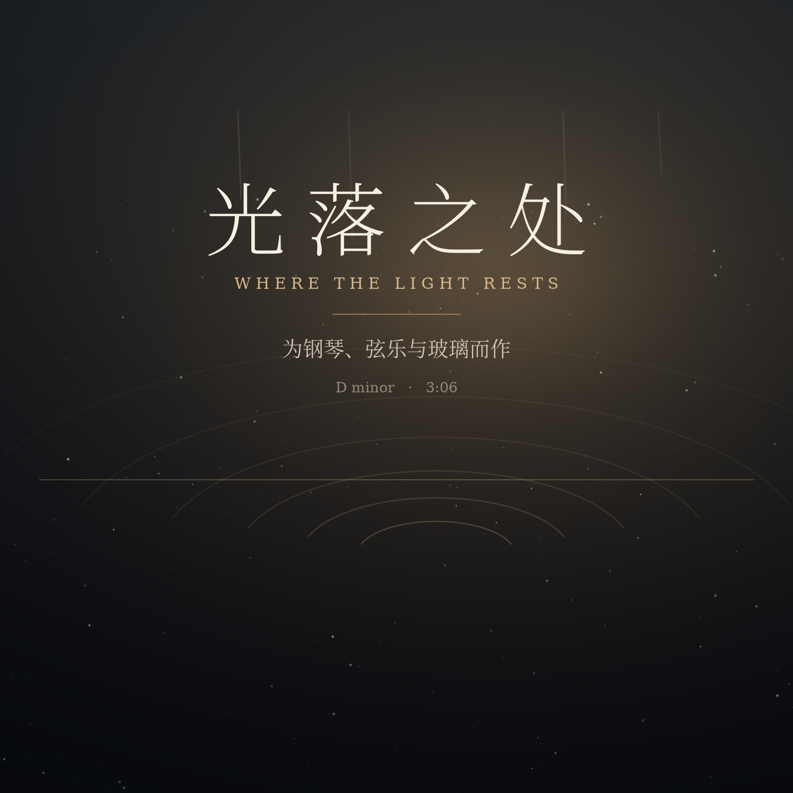

# 光落之处 · Where the Light Rests

为钢琴、弦乐与玻璃而作的纯音乐 · D 小调 · 3:06 · 63 BPM



> 试听：[where-the-light-rests.mp3](where-the-light-rests.mp3)

一个关于光的黄昏：从几乎听不见的夜色开始，光慢慢落下来，
在弦乐涌起的那一刻铺满整个画面，然后一点点退回到静默里。

---

## 结构

| 段落 | 小节 | 时间 | 和声走向 | 发生了什么 |
|------|------|------|----------|-----------|
| 前奏 Intro | 1–4 | 0:00 | Dm – B♭ – F – C | 只有稀疏的分解和弦与远处的玻璃声，第三条弦乐悄悄浮起 |
| 主题 A | 5–12 | 0:15 | Dm – B♭ – F – C – Dm – Gm – B♭ – A | 旋律第一次出现：D–F–E–D 的回转，落在 C♯ 上悬而未决 |
| 主题 A′ | 13–20 | 0:47 | Dm – B♭ – F/A – C – Dm – Gm⁷ – B♭add9 – A | 同一动机换气再唱一遍，琶音改为下行，推向 A 大调 |
| 展开 Lift | 21–28 | 1:18 | F – C/E – Dm – B♭ – F/A – Gm⁷ – C – C | 转到大调色彩，旋律升高八度，弦乐加厚 |
| 高潮 Climax | 29–38 | 1:50 | B♭add9 – F/A – Gm – Dm – B♭ – C – Dmadd9 – B♭add9 – Gm⁷ – A | 十六分音符琶音铺开，旋律到 C6，弦乐满弓 |
| 尾声 Coda | 39–44 | 2:29 | Dmadd9 – B♭add9 – Fadd9 – Dmadd9 – Dm | 旋律一路下行，最后一个 D 小调和弦在混响里散开 |

整首的旋律是一条拱形：D5 起，经 A5 到 C6，再回到 D5。

## 声音是怎么来的

没有任何采样、音源或外部素材——每一个音都是算出来的：

* **钢琴**：24 个非谐分音（弦的劲度造成的高次泛音偏移），每音三条微失谐的弦
  产生缓慢拍频，加锤击噪声与两段式衰减（先亮后收，像真的琴槌）。
* **弦乐**：三层失谐的加法合成，4.6 Hz 颤音、缓慢音高漂移、慢起慢收。
* **低音**：正弦加二次谐波，只为托住底部。
* **玻璃**：非整数倍泛音的钟，用在句尾当一点光。
* **混响**：程序生成的 4.2 秒大厅脉冲响应（分频段衰减 + 早期反射），
  用 FFT 卷积，只送给钢琴、弦乐和玻璃，低音保持干声。

混音按分轨电平管理，主总线做 34 Hz 高通、330 Hz 收一点、3.4 kHz 与 8.5 kHz 提亮，
最后是 -1.3 dBFS 峰值、-15.3 LUFS 的母带。

## 文件

| 文件 | 说明 |
|------|------|
| `where-the-light-rests.mp3` | 320 kbps，随手听 |
| `where-the-light-rests.wav` | 24-bit / 44.1 kHz 母带（未入库，跑一次 `arrange.py` 即得） |
| `where-the-light-rests.flac` | 无损 |
| `where-the-light-rests.mid` | 5 轨 MIDI（旋律 / 琶音 / 弦乐 / 低音 / 速度表），可换真钢琴音色 |
| `cover.png` | 封面 |
| `pianoroll.png` | 全曲钢琴卷帘（配器检查用） |
| `synth.py` | 乐器合成 |
| `arrange.py` | 编曲、混音、母带 |
| `export_midi.py` | 导出 MIDI |
| `make_cover.py` / `plot_score.py` | 封面与卷帘图 |

## 重新生成

```bash
python3 -m venv .venv && .venv/bin/pip install -r requirements.txt
.venv/bin/python arrange.py            # 合成 + 混音（约 3 分钟）
.venv/bin/python arrange.py --mix-only # 只重混（需要上次生成的 stems.npz）
.venv/bin/python export_midi.py
```

想改速度、和声或旋律，只需要动 `arrange.py` 顶部的 `BPM`、`PROG`、`MELODY` 三张表。

## License

代码用 MIT；音乐、乐谱与图像用 CC BY 4.0（署名即可商用）。
详见 [LICENSE](LICENSE)。

---

如果这首曲子让你想起某个下午，欢迎拿去做视频配乐、改编或重编曲。
